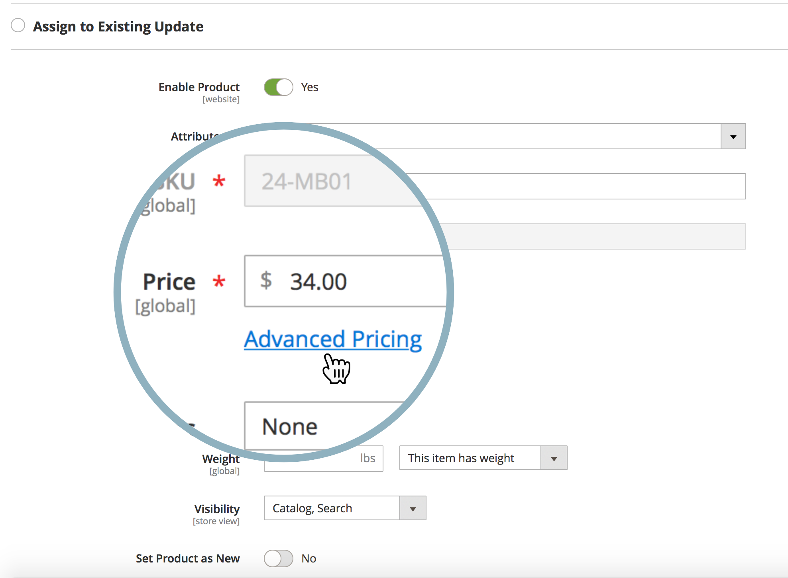
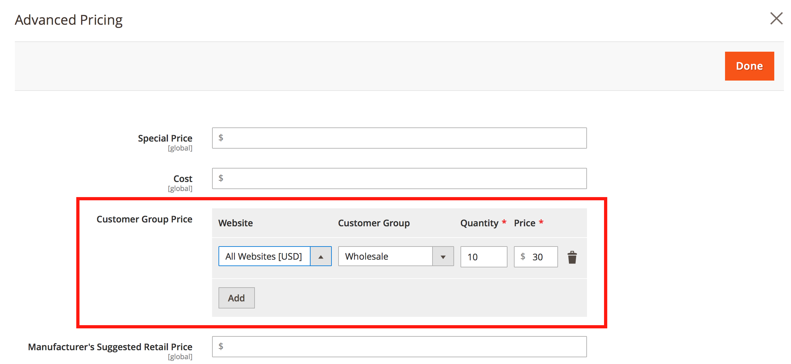

# Kann ich Aktualisierungen der Inhalts-Staging-Umgebung für Preise in einem freigegebenen Katalog planen?

Adobe Commerce bietet nicht die Möglichkeit, eine Preisaktualisierung ([Content-Staging](https://experienceleague.adobe.com/docs/commerce-admin/content-design/staging/content-staging.html?lang=de)) für ein oder mehrere Produkte in einem freigegebenen Katalog zu planen.

Das bedeutet, dass Sie eine solche Preisaktualisierung nicht direkt über das Menü **Preise und Struktur festlegen** im Admin-Bedienfeld von Commerce planen können (es gibt keine Schaltfläche **Neue Aktualisierung planen** in diesem Menü).

Sie können jedoch auch alternative Methoden verwenden und eine Preisaktualisierung für Folgendes planen:

* Eine Kundengruppe
* Der Grundpreis des Produkts

## Planen der Preisaktualisierung für eine Kundengruppe

1. Starten Sie [Planung einer neuen Produktaktualisierung](https://experienceleague.adobe.com/docs/commerce-admin/content-design/staging/content-staging-scheduled-update.html?lang=de).
1. Scrollen Sie nach unten zum Feld **Preis** und klicken Sie auf **Erweiterte**&quot;.

   {width="600"}

1. Wählen Sie **Abschnitt „Kundengruppenpreis** die gewünschte Kundengruppe aus und legen Sie den aktualisierten Preis fest.

   {width="700"}

1. Planen Sie die Aktualisierung wie gewohnt ab.

In diesem Workflow können Sie den Preis nur für ein einzelnes Produkt aktualisieren. Eine Massenpreisaktualisierung ist nicht verfügbar.

Denken Sie daran: Freigegebene Kataloge nutzen die Kundengruppenpreise.

**Verwandte Dokumentation**

* [Planung einer Aktualisierung (Content-Staging](https://experienceleague.adobe.com/docs/commerce-admin/content-design/staging/content-staging-scheduled-update.html?lang=de) in unserem Benutzerhandbuch.
* [Advanced Pricing](https://experienceleague.adobe.com/docs/commerce-admin/catalog/products/pricing/pricing-advanced.html?lang=de) in unserem Benutzerhandbuch.

## Planen der Preisaktualisierung für den Basispreis

Siehe den entsprechenden Artikel: [Wie wirkt sich die Grundpreisänderung auf den Preis des geteilten Katalogs aus?](/help/faq/general/base-price-change-affect-on-shared-catalog-price.md) in unserer Support-Wissensdatenbank.
