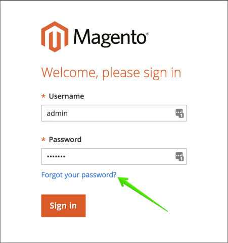

# Ändern des Administratorkennworts in Adobe Commerce in der Cloud-Infrastruktur

## Methode 1: Kennwort vergessen (per E-Mail zurücksetzen)

Lesen Sie die Schritte im Abschnitt [Zurücksetzen Ihres Kennworts bei Admin Sign-](https://experienceleague.adobe.com/docs/commerce-admin/start/admin/admin-signin.html#admin-sign-in)&quot; in unserem Benutzerhandbuch.

Nachfolgend finden Sie die kritischen Nutzungshinweise.

### Ausgehende E-Mails aktivieren

Bevor Sie das Formular **Kennwort vergessen** verwenden, stellen Sie sicher, dass Sie [ausgehende E-Mails aktivieren](https://experienceleague.adobe.com/docs/commerce-cloud-service/user-guide/project/outgoing-emails.html) mithilfe der [Cloud-Konsole](https://experienceleague.adobe.com/docs/commerce-cloud-service/user-guide/project/overview.html). Dies gilt nur für Integrationsumgebungen und Sandbox-Projekte.

Wenn ausgehende E-Mails in Pro Produktion oder Staging wirklich deaktiviert sind - was bedeutet, dass die E-Mail nicht von SendGrid aufgenommen wurde - können Sie dies überprüfen, indem Sie die Option [E-Mails in der Cloud-Konsole aktivieren](https://experienceleague.adobe.com/en/docs/commerce-on-cloud/user-guide/project/outgoing-emails#enable-emails-in-the-cli) aktivieren. Wenn das Problem weiterhin besteht, können Sie ein Adobe-Support[Ticket ](https://experienceleague.adobe.com/en/docs/commerce-knowledge-base/kb/help-center-guide/magento-help-center-user-guide).

### Junk-E-Mail-Ordner überprüfen

Wenn Sie die Nachricht mit dem Link „Kennwort zurücksetzen“ nicht finden können, überprüfen Sie Ihren Ordner *Junk-E-Mail*. Der Name der E-Mail lautet *Bestätigung für das Zurücksetzen des Kennworts für den Admin-Benutzernamen*.

## Methode 2: Neuen Admin-Benutzer hinzufügen

Wenn Sie das Kennwort für den vorhandenen Benutzer nicht wiederherstellen oder zurücksetzen können, können Sie einen neuen Admin-Benutzer erstellen und ein Kennwort für diesen Benutzer festlegen. Gehen Sie dazu wie folgt vor:

1. Verwenden Sie [SSH, um sich bei der Remote-Umgebung anzumelden](https://experienceleague.adobe.com/docs/commerce-cloud-service/user-guide/develop/secure-connections.html).
1. Führen Sie den folgenden Befehl aus: `bin/magento admin:user:create   --admin-user=%user_name% --admin-password=%your_password% --admin-email=%your_email% --admin-firstname=%admin_user_first_name% --admin-lastname=%admin_user_last_name%`
